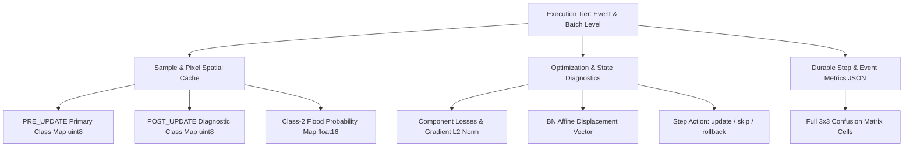

# ChangeGuard V3: Cache and Measurement Contract

**Date:** 2026-10-19  
**Repository:** `/usr1/home/s126mdg22_06/FYP_SARCD/ChangeGuard`  
**Governing Document:** [`docs/MASTER_EXECUTION_PLAN_V3.md`](file:///usr1/home/s126mdg22_06/FYP_SARCD/ChangeGuard/docs/MASTER_EXECUTION_PLAN_V3.md) (Section 3.4 & Section 6.1)  
**Active Work Package:** `E0` (Inventory & Planning/Measurement Gap Closure)  
**Status:** Approved Technical Contract for Work Package `E1` Implementation  

---

## 1. Specification Principles & Core Constraints

In test-time adaptation (TTA) research, downstream analyses frequently fail when recorders save only aggregated scalar metrics or loss values. Plan V3 establishes a strict, immutable contract for experimental caches and telemetry:

1. **Non-Reconstructibility Rule:**
   - A hard class prediction map ($\{0, 1, 2\}$) **cannot** reconstruct posterior class probabilities, entropy, or Kullback-Leibler (KL) divergence.
   - A scalar loss value **cannot** reconstruct gradient norms or parameter displacement vectors.
   - Retrospective event-level statistics **cannot** prove causal, advance-warning capability for online batch decisions.
2. **Phase Isolation:**
   - `PRE_UPDATE`: Predictions and scores generated by the model in its state *prior* to observing gradients on the current test batch. This is the **authoritative primary prediction** for online streaming evaluation and decision-making.
   - `POST_UPDATE`: Predictions and diagnostics generated by the model in its updated state *after* the optimizer step. This is strictly a **diagnostic observation** of the update effect, evaluated against the identical batch.
3. **Double-Masking Standard:**
   - All evaluation metrics and valid pixel counts are evaluated on pixels satisfying:
     $$\text{valid\_mask} = (\text{MK0\_MNA} == 1) \land (\text{label} \ne 3)$$
   - Invalid pixels ($0$ in `MK0_MNA` or $3$ in ground truth) contribute zero loss, zero gradient, and are excluded from confusion counts.

---

## 2. Mandatory Cache Fields Specification

For every scientifically relevant adaptation run across all work packages (starting with `E1`), the recorder must collect and serialize the following fields across three structural tiers:

### 2.1 Tier 1: Per-Batch Step Telemetry (`step_records.json`)

Saved progressively after each physical microbatch/step:

| Field Name | Type / Precision | Phase | Description & Constraints |
| :--- | :--- | :---: | :--- |
| `step_index` | `int` | Both | 1-based sequential batch step within the event stream. |
| `event_id` | `int` | Both | KuroSiwo numeric event identifier (e.g. `279`). |
| `condition_id` | `str` | Both | Unique protocol condition name (e.g. `C3_anchored_consistency_v1`). |
| `batch_size` | `int` | Both | Actual number of samples in this batch (typically 16, or tail $\le 16$). |
| `sample_ids` | `List[str]` | Both | Ordered list of 32-character hexadecimal MD5 sample IDs. |
| `action` | `str` | Pre | Decision taken: `"update"`, `"skip"`, `"rollback"`, or `"fallback_source"`. |
| `update_applied` | `bool` | Post | Whether optimizer step and state update completed successfully. |
| `total_loss` | `float64` | Post | Total scalar objective minimized on this batch. |
| `consistency_loss` | `float64` | Post | Weak-strong consistency loss component (or `0.0` if inapplicable). |
| `anchor_loss` | `float64` | Post | Source anchor loss component (or `0.0` if inapplicable). |
| `gradient_norm_l2` | `float64` | Post | $L_2$ norm of parameter gradients prior to optimizer step. |
| `bn_weight_displacement`| `float64` | Post | $L_2$ Euclidean distance between adapted and source BN weight vectors. |
| `bn_bias_displacement` | `float64` | Post | $L_2$ Euclidean distance between adapted and source BN bias vectors. |
| `valid_pixels` | `int` | Pre | Total pixels with $\text{valid\_mask} == 1$ in the batch. |
| `selected_pixels` | `int` | Pre | Total pixels passing the confidence / selection mask. |
| `selected_pixels_c0` | `int` | Pre | Count of selected pixels predicted as Class 0 (Land). |
| `selected_pixels_c1` | `int` | Pre | Count of selected pixels predicted as Class 1 (Permanent Water). |
| `selected_pixels_c2` | `int` | Pre | Count of selected pixels predicted as Class 2 (Flood Water). |
| `mean_entropy` | `float64` | Pre | Mean predictive entropy over sensory-valid pixels. |
| `mean_max_confidence` | `float64` | Pre | Mean maximum softmax probability over valid pixels. |
| `null_score_s_null` | `float64` | Pre | Temporal probe risk score on identical pairs (if probe enabled; else `null`). |
| `batch_time_ms` | `float64` | Post | Wall-clock execution time for this batch in milliseconds. |
| `peak_vram_mb` | `float64` | Post | Peak allocated CUDA memory during batch in Megabytes. |
| `failure_reason` | `str` or `null` | Post | Explicit diagnostic message if numerical or update check failed. |

---

### 2.2 Tier 2: Spatial Prediction & Probability Arrays (`frozen_predictions.npz`)

Persisted per event upon completion of the adaptation stream:

| Array Key Pattern | Shape / Dtype | Phase | Storage Policy & Interpretation |
| :--- | :--- | :---: | :--- |
| `{sample_id}_pred` | $(224, 224)$, `uint8` | `PRE_UPDATE` | **Mandatory.** Authoritative primary discrete prediction $\in \{0, 1, 2\}$. |
| `{sample_id}_post_pred` | $(224, 224)$, `uint8` | `POST_UPDATE` | **Mandatory where updates occur.** Discrete prediction on current batch under updated weights. Used to evaluate batch-level update impact. |
| `{sample_id}_prob_c2` | $(224, 224)$, `float16` | `PRE_UPDATE` | **Mandatory.** Softmax probability of Class 2 (Flood Water). Compressed to half-precision float to conserve disk space. |
| `{sample_id}_src_prob_c2`| $(224, 224)$, `float16` | `FROZEN_SRC` | Softmax probability of Class 2 from immutable source model. May be saved once per checkpoint or referenced via immutable hash pointer. |

---

### 2.3 Tier 3: Event-Level Summary & $3 \times 3$ Confusion Cells (`event_metrics.json`)

Saved upon stream completion after offline ground-truth comparison:

| Metric Category | Field Names | Mathematical Formulation / Invariant |
| :--- | :--- | :--- |
| **Identification** | `event_id`, `sample_count`, `batch_count`, `batch_sizes` | $N_{\text{samples}} = \sum \text{batch\_sizes}$ |
| **Binary Confusion** | `tp`, `fp`, `fn`, `tn`, `valid_pixels` | $\text{valid\_pixels} = \text{tp} + \text{fp} + \text{fn} + \text{tn}$ |
| **$3 \times 3$ Confusion Cells** | `c00_land_land`, `c01_land_perm`, `c02_land_flood_FP` `c10_perm_land`, `c11_perm_perm`, `c12_perm_flood_FP` `c20_flood_land_FN`, `c21_flood_perm_FN`, `c22_flood_flood_TP` | $\sum_{i=0}^2 \sum_{j=0}^2 C_{ij} = \text{valid\_pixels}$ $\text{FP} = C_{02} + C_{12}$ $\text{FN} = C_{20} + C_{21}$ $\text{TP} = C_{22}$ |
| **Performance Scores** | `precision`, `recall`, `f1`, `iou` | Full 64-bit IEEE floating-point precision. |
| **Update Accounting** | `updates_applied`, `updates_skipped`, `updates_failed` | Total steps $= \text{applied} + \text{skipped} + \text{failed}$ |

---

## 3. Inventory of Current Artifacts vs. Contract

An empirical inventory of the current repository artifacts (Weeks 11C, 12, 13, and 14) reveals the exact coverage and measurement gaps:

| Telemetry / Cache Dimension | Current Status | Available In Existing Artifacts? | Derivable From Existing Files? | Requiring New Measurement (Gap in E1)? |
| :--- | :--- | :---: | :---: | :---: |
| **Provenance Identifiers** | Checkpoint hash, config hash, git commit | **YES** | Yes (in manifests) | None. |
| **PRE_UPDATE Predictions** | Primary class map `{sample_id}` ($224 \times 224$ `uint8`) | **YES** | Yes (`frozen_predictions.npz`) | None for W12/W13; required for W8/W9 baselines. |
| **POST_UPDATE Predictions** | Post-step class map `{sample_id}_post_pred` | **NO** | **NO** | **REQUIRED IN E1 RECORDER.** |
| **Class-2 Probability Maps** | Spatial flood probability ($224 \times 224$ `float16`) | **NO** | **NO** | **REQUIRED IN E1 RECORDER.** |
| **Null-Pair Probabilities** | $s_{\text{null}}$ temporal probe scores ($z \in \{\text{pre2/pre2}, \text{post/post}\}$) | **NO** | **NO** | **REQUIRED IN E5.** |
| **Per-Class Selection Counts** | $N_{\text{sel}, c0}, N_{\text{sel}, c1}, N_{\text{sel}, c2}$ | **NO** | Can be approximated by masking predictions, but exact pre-step selection missing | **REQUIRED IN E1/E2.** |
| **Gradient $L_2$ Norm** | $\|\nabla_{\theta} L\|_2$ vector norm | **NO** | **NO** | **REQUIRED IN E1 RECORDER.** |
| **BN Affine Displacement** | $\|\theta_{\text{bn}} - \theta_{\text{bn, src}}\|_2$ | Exists in W9; absent in W12/W13 | **NO** | **REQUIRED IN E1 RECORDER.** |
| **$3 \times 3$ Confusion Counts** | $C_{00} \dots C_{22}$ per event and pooled | **YES** | Yes (Week 14 offline CSVs) | Must be exported natively in future runs. |
| **Update / Skip / Failure Totals** | Counters in `event_metrics.json` | **YES** | Yes | None. |

---

## 4. Storage Budget & Retention Rules

### 4.1 Storage Estimation per Full Adaptation Stream (6 Development Events)
- Number of samples across dev6: $2,826$ patches ($224 \times 224$).
- Raw prediction map (`uint8`): $2,826 \times 224 \times 224 \times 1\text{ byte} \approx 141.8\text{ MB}$ uncompressed (compressed NPZ: $\approx 2.3\text{ MB}$).
- Post-update prediction map (`uint8`): $\approx 2.3\text{ MB}$ compressed.
- Half-precision Class-2 probability map (`float16`): $2,826 \times 224 \times 224 \times 2\text{ bytes} \approx 283.6\text{ MB}$ (compressed NPZ: $\approx 45\text{ MB}$).
- Telemetry JSON files (`step_records.json`, `event_metrics.json`): $\approx 250\text{ KB}$.
- **Total storage per 6-event stream:** Approximately **$50\text{ MB}$** on disk.
- **Full Confirmation Matrix (12 streams per method):** $12 \times 50\text{ MB} \approx \mathbf{600\text{ MB}}$ per full method. The host server (`gpu22`) has over $4.4\text{ TB}$ free capacity on `/usr1`; storage budget is entirely viable.

### 4.2 Git Quarantine & Retention Policy
- Binary prediction arrays (`*.npz`), detailed logs (`*.log`), and model tensors are strictly ignored by `.gitignore` and must **never** be committed to Git.
- Lightweight tabular digests (`stream_event_metrics.csv`, `class_confusion_3x3.csv`, `summary_metrics.csv`, `artifact_sha256.txt`) remain under version control.
- All binary artifacts must be mirrored to independent backup storage upon completion of each major work package.

