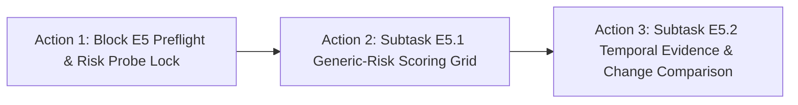

# ChangeGuard V3: Current Research Status & Work Package Dashboard

**Date:** 2026-10-20  
**Repository:** `/usr1/home/s126mdg22_06/FYP_SARCD/ChangeGuard`  
**Git Branch & HEAD:** `main`  
**Active Work Package:** Block E4 `COMPLETE` (Promotion: `NONE ELIGIBLE` / `NONE RETAINED`); Block E5 `READY`  
**Governing Document:** [`docs/MASTER_EXECUTION_PLAN_V3.md`](file:///usr1/home/s126mdg22_06/FYP_SARCD/ChangeGuard/docs/MASTER_EXECUTION_PLAN_V3.md)  
**Verification Provenance:** Implementer Self-Verification (Python `vfm_env`)  

---

## 1. Executive Summary & V3 Transition

On October 19, 2026, the ChangeGuard project formally transitioned from historical weekly exploratory tracking to the **Master Execution Plan V3**, establishing a unified, defensible timeline and methodology leading up to the final FYP submission in May 2027.

Under Plan V3, research execution is organized into twelve structured work packages: **`E0` through `E11`**. Historical week labels (`Week 0`–`Week 14`) remain immutable reference names for existing evidence, protocols, and artifacts, but future work is governed strictly by the V3 work-package specifications.

---

## 2. Work Package Completion Dashboard (`E0` – `E11`)

| Work Package | Calendar Window | Scope & Description | Status | Tangible Evidence / Key Outputs |
| :--- | :---: | :--- | :---: | :--- |
| **`E1`** | Oct 23 – Nov 1 | Extended Recorder, Matched Baselines & Normalization Checks | **COMPLETED** | **Subtask E1.1 COMPLETE** (`src/changeguard/recorder.py`, `tests/test_extended_recorder.py`). **Subtask E1.2 COMPLETE** (`src/changeguard/e1_orchestrator.py`, `tests/test_e1_orchestration_synthetic.py`). **Subtask E1.3 COMPLETE** (`tools/run_e1_3_real_smoke.py`, `docs/e1_3_smoke_closeout.md`). **Subtask E1.4 COMPLETE** (`outputs/e1_matched_baselines/v1/`, `master_coverage_table.json`, `docs/e1_4_matched_baselines_closeout.md`). **Subtask E1.5 COMPLETE** (`outputs/e1_bn_normalization/v1/`, `master_coverage_table.json`, `docs/e1_5_bn_normalization_closeout.md`, `tools/verify_e1_5_integrity.py`). **Subtask E1.6 COMPLETE** (`outputs/e1_synthesis/v1/`, `master_baseline_table.json`, `docs/e1_6_baseline_synthesis_closeout.md`, `tools/verify_e1_synthesis.py`). Block E1 terminally closed. |
| **`E2`** | Oct 26 – Nov 8 | Confidence & Augmentation Comparison | **COMPLETED** | **Subtask E2.1 COMPLETE** (`outputs/e2_confidence_grid/v1/`, `master_confidence_grid.json`, `docs/e2_1_confidence_grid_closeout.md`, `tools/verify_e2_1_integrity.py`). **Subtask E2.2 COMPLETE** (`outputs/e2_augmentation_grid/v1/`, `master_augmentation_grid.json`, `master_augmentation_grid.md`, `docs/e2_2_augmentation_grid_closeout.md`, `tools/verify_e2_2_integrity.py`). Cells A0, A1, A2, A3 completed; A4 formally blocked. **Subtask E2.3 COMPLETE** (`outputs/e2_repeat_matrix/v1/`, `master_repeat_matrix.json`, `master_repeat_matrix.md`, `docs/e2_3_promotion_and_repeat_closeout.md`, `tools/verify_e2_3_integrity.py`). Directionally and numerically consistent $\tau=0.90$ vs $\tau=0.00$ across the two tested seed/order settings ($+0.00006$ macro F1, 50% gradient reduction). Standalone method promotion: `NONE RETAINED`; base consistency recipe retained for E3. **Subtask E2.4 COMPLETE** (`outputs/e2_synthesis/v1/`, `master_e2_synthesis.json`, `master_e2_synthesis.md`, `docs/e2_4_synthesis_closeout.md`, `tools/verify_e2_synthesis.py`). Block E2 terminally closed. |
| **`E3`** | Nov 2 – 15 | Bounded Source-Anchor Comparison | **COMPLETED** | **Subtask E3.1 COMPLETE** (`src/changeguard/e3_anchor_adapters.py`, `tests/test_e3_anchor_contracts.py`, `docs/e3_preflight_and_contracts.md`). All contracts, adapters, gradient telemetry, and bounded GPU smoke tests verified. **Subtask E3.2 COMPLETE** (`outputs/e3_source_anchor/v1/`, `master_source_anchor_table.json`, `master_source_anchor_table.md`, `docs/e3_2_anchor_screening_closeout.md`, `tools/verify_e3_synthesis.py`). All 9 locked cells evaluated across 6 development events. Decomposed gradient telemetry and offline harmful-recovery vs beneficial-loss metrics verified. Standalone method promotion: `NONE RETAINED` (all 9 cells failed verbatim Plan V3 promotion rules; $\Delta\text{WorstEvent} \equiv 0.0$). **Subtask E3.3 COMPLETE** (Matched-control reconciliation in `docs/e3_control_provenance_reconciliation.md`, master synthesis tables in `outputs/e3_synthesis/v1/`, terminal closeout in `docs/e3_3_terminal_closeout.md`). Promotion verdict: `NONE RETAINED`; repeat experiments `NOT REQUIRED — NONE PASSED PROMOTION RULE`. Block E3 terminally closed. |
| **`E4`** | Nov 16 – 22 | Class-Aware Interventions | **COMPLETED** | **Subtask E4.1 COMPLETE** (`src/changeguard/e4_class_aware_adapters.py`, `tests/test_e4_class_aware_contracts.py`, `configs/changeguard/e4_class_aware_screening_v1.json`, `tools/run_e4_class_aware_screening.py`, `docs/e4_preflight_and_contracts.md`). Quarantined GPU smoke validation completed on Event 520. **Subtask E4.1b COMPLETE** (Research-validity audit & contract correction: K1 uniform per-class cap $\lfloor N_{eligible}/3 \rfloor$; K3 source-permanent-water exclusion $\hat{y}_{src}==1$; fail-closed ground-truth sealing lifecycle verified; matched control reuse audit for `E4_BASE` $\equiv$ `E2_CONF_90`; 15/15 unit tests and 56/56 cross-block regression tests pass). **Subtask E4.2 COMPLETE** (`outputs/e4_class_aware/v1/`, `master_e4_screening_table.json`, `master_e4_screening_table.md`, `master_e4_class_error_table.md`, `master_e4_transitions_table.md`, `master_e4_telemetry_table.md`, `master_e4_runtime_memory_table.md`, `docs/e4_2_screening_closeout.md`, `tools/verify_e4_synthesis.py`). All 4 K cells evaluated across 6 development events. Promotion verdict: `NONE ELIGIBLE` (all 4 failed Plan V3 promotion rules; $\Delta\text{WorstEvent} = -0.008429$). **Subtask E4.3 COMPLETE** (Repeats `NOT REQUIRED` per Plan V3 Section 9.3; negative-result terminal closeout route applied). Block E4 terminally closed. |
| **`E5`** | Nov 23 – 29 | Temporal Evidence & Generic-Risk Comparison | **READY** | Pre-conditions met; E4 terminal closeout complete. Ready for E5 preflight and protocol lock upon authorization. |
| **`E6`** | Nov 30 – Dec 6 | Feasibility Decision (Gate E) & Nearest Baselines | **INACTIVE** | Inactive until E5 satisfies exit conditions. Formal review to choose Branch A, B, or C. |
| **`E7`** | Dec 7 – 13 | Policy Implementation or Empirical Framework | **INACTIVE** | Inactive until E6 Gate E decision is rendered. |
| **`E8`** | Dec 14 – Jan 3 | LOEO Cross-Event Evaluation & Full Confirmation | **INACTIVE** | Inactive until E7 implementation passes verification. |
| **`E9`** | Dec 21 – Jan 3 | Required Ablations & Method Freeze | **INACTIVE** | Inactive until E8 full confirmation completes. |
| **`E10`** | Jan 4 – 31 | Robustness & Publication Extensions | **INACTIVE** | Inactive until E9 method freeze is established. |
| **`E11`** | Feb 1 – May 19 | Frozen Final Evaluation & FYP Delivery | **INACTIVE** | Inactive until Gate T release. Reserved test partition strictly quarantined. |

---

## 3. Completed Historical Work Mapped to V3 Assets

| Historical Stage | Completed Evidence & Artifacts | Primary Finding / Conclusion | V3 Asset Role |
| :--- | :--- | :--- | :--- |
| **Weeks 0–3** | Source split v1 (22/5), Model A vs B comparison across seeds 0, 1, 2. | Model B (`[VV, VH, slope]`) flipped sign across seeds; Model A (`[VV, VH]`) selected as primary. | Baseline foundation; slope scope frozen. |
| **Week 5** | Source training recipe review (`docs/week5_source_recipe_review.md`). | Locked epoch budget: $E_{\text{final}} = \text{median}(8, 16, 32) = 16$ epochs; FP32 single precision. | Frozen source training protocol. |
| **Week 6** | All-27 Model A training across seeds 0, 1, 2 (`outputs/week5_source_all27/`). | 3 canonical checkpoints saved, verified finite, and backed up in local `/usr1` backup storage. | Authoritative primary source checkpoints. |
| **Weeks 7–9** | Source baseline, AdaBN, Tent, EATA, SAR runs. | Baseline performance established, but lacked spatial prediction caching and used POST_UPDATE. | Reused conditionally; matched PRE_UPDATE replays in E1. |
| **Week 11** | Bounded real smoke (`outputs/week11_real_smoke/approved_smoke_event520_v1/`). | Validated double-masking, batching, and fail-fast rollback on 50 real SAR samples. | Proven execution and testing foundation. |
| **Week 12** | Seed 0 exploratory ablation (`outputs/week12_ablation/approved_dev6_s0_v1/`). | Evaluated Source, Tent, C1 (no conf), C2 (conf 0.90) on 6 dev events ($N=2,826$). | Exploratory evidence; reused in E2 confidence grid. |
| **Week 12 BN** | BN normalization diagnostic (`outputs/week12_ablation/approved_bn_diagnostic_dev6_s0_v1/`). | Demonstrated that candidate batch statistics without updates cause degradation comparable to Tent. | Authoritative normalization contrast for Seed 0. |
| **Week 13** | Source probability anchor ($\lambda=0.50$, `outputs/week13_source_anchor/`). | Anchor reduced disagreement with source, but improved aggregate F1 by only $+0.00095$ vs BN. | Reused as $\lambda=0.50$ cell in E3 anchor grid. |
| **Week 14** | Offline $3 \times 3$ error diagnosis (`outputs/week14_offline_diagnosis/`). | Decomposed errors: Event 279 FP surge is $97.37\%$ dry Land misclassified as Flood ($C_{02}$). | Empirical foundation for E4 class-aware interventions. |

---

## 4. Concrete Blockers, Risks & Unresolved Decisions

1. **Backup Verification & Physical Isolation Status:**
   - *Current State:* Week 6 source checkpoints have a verified on-disk copy at `/usr1/home/s126mdg22_06/FYP_SARCD/backups/week6_all27_source_models_20261016` (33 files, 828.07 MB, verified via `sha256sum -c`). However, this is a **same-host local directory** on the same physical server (`gpu22`), not an independent off-server or cloud backup.
   - *Unverified Outputs:* Post-Week 6 experimental outputs (Weeks 8, 9, 11, 12, 13, 14) reside exclusively inside local repository directory `outputs/`. Their cryptographic inventories (`artifact_sha256.txt`) exist in Git, but secondary backup copies (even local ones) are currently **unrecorded and unverified**.
   - *Policy Standard:* We do not claim unverified backups are verified, nor do we claim same-host copies are off-server backups. Synchronizing to a verified off-server/independent destination remains an operational requirement prior to final evaluation.
2. **Slope Scope Formal Clarification:**
   - *Resolution:* Section 5.1 of Plan V3 explicitly checked the slope scope. Model A (`[VV, VH]`) was frozen as the primary architecture; Model B exists only as an inner-split source ablation. No all-27 Model B checkpoint exists, and none is required unless channel generalization to slope is claimed.
3. **Selection of Second Lightweight Backbone for Block E10:**
   - *Decision Window:* Methodological selection must occur by January 10, 2027. Candidate models must support dense paired SAR segmentation and three-class change detection (e.g. lightweight Siamese UNet or BIT-CD).
4. **Tool-Availability Transition (November 8):**
   - *Risk:* Transition from Antigravity to VS Code Codex on November 8.
   - *Mitigation:* Full standalone CLI test runners, environment specs, and documentation ensure uninterrupted execution post-November 8.

---

## 5. Next Three Actions with Dependencies

1. **Action 1: Block E5 Preflight & Risk Probe Protocol Lock**
   - *Scope:* Formal preflight verification, locking probe signal definitions ($s_{\text{null}}$, generic entropy, confidence, source disagreement, BN displacement), state-neutral probe interfaces, and zero-leakage assertions.
   - *Status:* NEXT (ready to execute upon user authorization).
   - *Dependencies:* Block E4 terminal closeout accepted.
2. **Action 2: Subtask E5.1: Generic-Risk Scoring Grid**
   - *Scope:* Evaluate generic entropy, confidence, and source KL risk indicators on candidate model states against the BN-no-update probe control.
   - *Dependencies:* Action 1 preflight approved.
3. **Action 3: Subtask E5.2: Temporal Evidence & Change Comparison**
   - *Scope:* Evaluate identical-time pairs (`pre2/pre2`, `post/post`) and real pairs (`pre2/post`) to characterize false change dynamics without test label access.
   - *Dependencies:* Subtask E5.1 completed and audited.

---

## 6. Authoritative Result Paths & Data Split Boundaries

### 6.1 Checkpoints & Frozen Splits
- **All-27 Source Checkpoints:** `outputs/week5_source_all27/source_snunet_vvvh_all27_seed{0,1,2}_v1_fp32/final_checkpoint.pt`
- **Source Training Split (27 events, 21,462 patches):** `configs/splits/kuro_source_all27_split_v1.json`
- **Evaluation Manifest:** `configs/splits/KuroV2_grid_dict_test_0_100.gz`

### 6.2 Authoritative Experimental Outputs
- **Week 11C Smoke:** `outputs/week11_real_smoke/approved_smoke_event520_v1/`
- **Week 12 Exploratory Ablation:** `outputs/week12_ablation/approved_dev6_s0_v1/`
- **Week 12 BN Normalization Diagnostic:** `outputs/week12_ablation/approved_bn_diagnostic_dev6_s0_v1/`
- **Week 13 Source Anchor Experiment:** `outputs/week13_source_anchor/approved_dev6_s0_v1/`
- **Week 14 Offline Class Error Diagnosis:** `outputs/week14_offline_diagnosis/`
- **Block E1 Matched Baselines & Normalization:** `outputs/e1_matched_baselines/v1/`, `outputs/e1_bn_normalization/v1/`, `outputs/e1_synthesis/v1/`
- **Block E2 Confidence & Augmentation Synthesis:** `outputs/e2_confidence_grid/v1/`, `outputs/e2_augmentation_grid/v1/`, `outputs/e2_repeat_matrix/v1/`, `outputs/e2_synthesis/v1/`
- **Block E3 Bounded Source-Anchor Synthesis:** `outputs/e3_source_anchor/v1/`, `outputs/e3_synthesis/v1/`
- **Block E4 Class-Aware Screening Synthesis:** `outputs/e4_class_aware/v1/`

### 6.3 Protected Partition Quarantine Status
- **Development Partition (6 events):** `[279, 437, 520, 559, 1111003, 1111008]` ($2,826$ patches). Open for development-time adaptation, offline diagnosis, and LOEO evaluation.
- **Sealed Test Partition (10 events):** `[205, 277, 321, 411, 445, 561, 562, 1111002, 1111007, 1111013]` ($1,093$ patches). **Strictly quarantined and unopened.** Zero test rasters opened, zero labels accessed. Unsealing is authorized exclusively at Gate T (March 2027).

---

## 7. Review & Verification Provenance Disclosure

In compliance with scientific transparency standards:
- **Historical External / Multi-Session Reviews:** Weeks 9, 11A, 11C (v1/v2) independent review documents are preserved under `docs/reviews/` with their original findings and remediations.
- **Current Development Phase:** All work from Week 11C closeout through Week 14 offline diagnosis and Work Package E0 represents **Implementer-Owned Self-Verification** conducted under Python `/usr1/home/s126mdg22_06/miniconda3/envs/vfm_env/bin/python`.
- **Policy Rule:** Implementer self-verifications are explicitly disclosed and never mislabeled as third-party or independent reviews.

