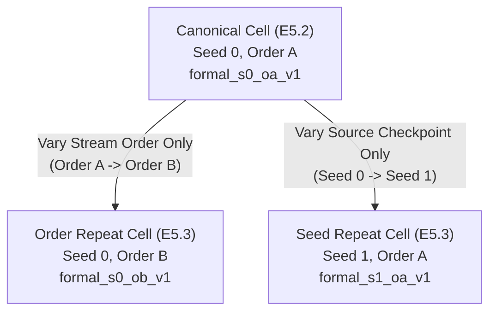

# ChangeGuard Work Package E5.3: Orthogonal Repeat Evidence Prelaunch Verification

> [!IMPORTANT]
> **Prelaunch Status: VERIFIED & FROZEN — READY FOR COMMIT AND FORMAL REPEAT LAUNCH**
> - **Governing Plan:** [`docs/MASTER_EXECUTION_PLAN_V3.md`](file:///usr1/home/s126mdg22_06/FYP_SARCD/ChangeGuard/docs/MASTER_EXECUTION_PLAN_V3.md), Block E5.3
> - **Execution Architecture:** Two isolated orthogonal cells to separately disentangle streaming order sensitivity and source-seed parameter sensitivity.
> - **Target Cells:**
>   1. **Cell 1 (Order Repeat):** Checkpoint Seed 0, Stream Arrival Order B (`formal_s0_ob_v1`)
>   2. **Cell 2 (Seed Repeat):** Checkpoint Seed 1, Stream Arrival Order A (`formal_s1_oa_v1`)
> - **Zero Sealed-Test Access:** Strictly quarantined (`[205, 277, 321, 411, 445, 561, 562, 1111002, 1111007, 1111013]` unaccessed)
> - **GPU Launch Policy:** No GPU job executed during this task. Isolated execution commands prepared for distinct physical GPUs.

---

## 1. Scientific Objective & Factor Disentanglement

In Work Package E5.2, formal evidence collection and offline risk analysis were established on the canonical exploratory cell **Seed 0, Stream Order A (`formal_s0_oa_v1`, `analysis_s0_oa_v2`)**.

To test whether the observed pre-update risk indicators (such as `source_to_candidate_kl` and `s_flood_expansion`) and adaptation degradation regimes are stable across temporal ordering and model weight initialization, Work Package E5.3 executes two **orthogonal one-factor repeat cells**:



1. **Order Repeat Cell (`e5_temporal_risk_s0_ob_v1`)**:
   - **Purpose:** Disentangles the effect of temporal event sequence and within-event sample presentation order while keeping source model parameters fixed.
   - **Variation:** Stream Order B (reverse event sequence `[1111008, 1111003, 559, 520, 437, 279]`, descending sample IDs within each event).
   - **Invariant:** Identical source checkpoint (Seed 0).

2. **Seed Repeat Cell (`e5_temporal_risk_s1_oa_v1`)**:
   - **Purpose:** Disentangles the effect of initial source model parameter representations while keeping stream presentation order fixed.
   - **Variation:** Source Checkpoint Seed 1 (`final_checkpoint.pt` trained with seed 1).
   - **Invariant:** Canonical Stream Order A (`[279, 437, 520, 559, 1111003, 1111008]`, ascending sample IDs).

> [!CAUTION]
> These cells must separately test order sensitivity and source-seed sensitivity. Under no circumstances should they be replaced by a combined compound cell (`seed1_orderB`), which would entangle both variables and prevent causal attribution.

---

## 2. Invariants and Permitted Differences

| Dimension | Canonical Cell (`formal_s0_oa_v1`) | Repeat Cell 1 (`formal_s0_ob_v1`) | Repeat Cell 2 (`formal_s1_oa_v1`) | Invariant / Permitted Difference |
| :--- | :--- | :--- | :--- | :--- |
| **Source Checkpoint Seed** | `0` | `0` | **`1`** | **Permitted difference in Cell 2 only** |
| **Source Checkpoint SHA-256** | `247d3584...` | `247d3584...` | **`72c4be78...`** | Verified bit-exact |
| **Stream Presentation Order** | `order_a` | **`order_b`** | `order_a` | **Permitted difference in Cell 1 only** |
| **Event Sequence** | `[279, 437, 520, 559, 1111003, 1111008]` | `[1111008, 1111003, 559, 520, 437, 279]` | `[279, 437, 520, 559, 1111003, 1111008]` | Exact sequence matched to order |
| **Within-Event Sorting** | Ascending `sample_id` | Descending `sample_id` | Ascending `sample_id` | Exact sorting matched to order |
| **Target Event Count** | 6 development events | 6 development events | 6 development events | **Strictly invariant** |
| **Total Sample Count** | 2,826 samples | 2,826 samples | 2,826 samples | **Strictly invariant** |
| **Total Batch / Shard Count** | 179 shards | 179 shards | 179 shards | **Strictly invariant** |
| **Batch Size ($B$)** | 16 (`tail_batch_handling: process_as_is`) | 16 (`tail_batch_handling: process_as_is`) | 16 (`tail_batch_handling: process_as_is`) | **Strictly invariant** |
| **Candidate Adaptation Platform** | `candidate_e2_conf90` | `candidate_e2_conf90` | `candidate_e2_conf90` | **Strictly invariant** ($\tau=0.90$, LR $10^{-4}$, Adam, BN affine) |
| **Context Controls** | Source eval ref + Matched BN control | Source eval ref + Matched BN control | Source eval ref + Matched BN control | **Strictly invariant** |
| **Timing Policy** | `PRE_UPDATE` | `PRE_UPDATE` | `PRE_UPDATE` | **Strictly invariant** |
| **Persistence Boundary** | Disk flush before label interaction | Disk flush before label interaction | Disk flush before label interaction | **Strictly invariant** |
| **Sensory Mask Policy** | `MK0_MNA == 1` online; `MK0_MLU != 3` offline | `MK0_MNA == 1` online; `MK0_MLU != 3` offline | `MK0_MNA == 1` online; `MK0_MLU != 3` offline | **Strictly invariant** |
| **Risk Formulations & Directions** | Pre-declared directions ($s_{\text{null}}$, expansion, KL, etc.) | Identical | Identical | **Strictly invariant** |
| **Post-Hoc Composite Gate** | None (`NOT EVALUATED`) | None (`NOT EVALUATED`) | None (`NOT EVALUATED`) | **Strictly invariant** |
| **Sealed-Test Access** | Zero access (`quarantined`) | Zero access (`quarantined`) | Zero access (`quarantined`) | **Strictly invariant** |

---

## 3. Configuration & Checkpoint Hashes

### 3.1 Versioned Configuration Files
- **Order Repeat (`formal_s0_ob_v1`):**  
  File: [`configs/changeguard/e5_temporal_risk_s0_ob_v1.json`](file:///usr1/home/s126mdg22_06/FYP_SARCD/ChangeGuard/configs/changeguard/e5_temporal_risk_s0_ob_v1.json)  
  SHA-256: `8b2a114d0ad781c2caf703cd2796b78ae1b7f4ed80eda6ca67ad1e7318172e8d`
- **Seed Repeat (`formal_s1_oa_v1`):**  
  File: [`configs/changeguard/e5_temporal_risk_s1_oa_v1.json`](file:///usr1/home/s126mdg22_06/FYP_SARCD/ChangeGuard/configs/changeguard/e5_temporal_risk_s1_oa_v1.json)  
  SHA-256: `68ee371c1c235da11ee5f676cc4bca9c477a0f533571e681c80cec8fea944636`

### 3.2 Physical Checkpoints
- **Source Checkpoint Seed 0:**  
  Path: `outputs/week5_source_all27/source_snunet_vvvh_all27_seed0_v1_fp32/final_checkpoint.pt`  
  SHA-256: `247d358431f5c54c3d3d3421b4de6c4738ad457509900f8ddb717f5eef21087f` (Verified bit-exact)
- **Source Checkpoint Seed 1:**  
  Path: `outputs/week5_source_all27/source_snunet_vvvh_all27_seed1_v1_fp32/final_checkpoint.pt`  
  SHA-256: `72c4be7856fe4bb06560d61d3ab8e72780e81fdff84660f8dadfe2f8bd385d7a` (Verified bit-exact)

---

## 4. Expected Event Partitions & Shard Accounting

Both cells evaluate the identical 2,826 samples across the six development events, producing exactly 179 shards per run:

### 4.1 Order A Sequence (Canonical & Seed Repeat Cell 2)
$$\text{Sequence: } [279, 437, 520, 559, 1111003, 1111008]$$

| Event ID | Geographic Name | Sample Count | Batch Size | Shard / Batch Count | Sample Sort Direction |
| :---: | :--- | :---: | :---: | :---: | :---: |
| **279** | Spain / Ebro | 2,381 | 16 | 149 | Ascending (`s279_0000` $\rightarrow$ `s279_2380`) |
| **437** | UK / Severn | 169 | 16 | 11 | Ascending (`s437_0000` $\rightarrow$ `s437_0168`) |
| **520** | USA / Florence | 92 | 16 | 6 | Ascending (`s520_0000` $\rightarrow$ `s520_0091`) |
| **559** | USA / Midwest | 42 | 16 | 3 | Ascending (`s559_0000` $\rightarrow$ `s559_0041`) |
| **1111003** | Bangladesh / Ganges | 19 | 16 | 2 | Ascending (`s1111003_0000` $\rightarrow$ `s1111003_0018`) |
| **1111008** | Myanmar / Sagaing | 123 | 16 | 8 | Ascending (`s1111008_0000` $\rightarrow$ `s1111008_0122`) |
| **Total** | **6 Development Events** | **2,826** | **16** | **179** | **Ascending Sample IDs** |

### 4.2 Order B Sequence (Order Repeat Cell 1)
$$\text{Sequence: } [1111008, 1111003, 559, 520, 437, 279]$$

| Event ID | Geographic Name | Sample Count | Batch Size | Shard / Batch Count | Sample Sort Direction |
| :---: | :--- | :---: | :---: | :---: | :---: |
| **1111008** | Myanmar / Sagaing | 123 | 16 | 8 | Descending (`s1111008_0122` $\rightarrow$ `s1111008_0000`) |
| **1111003** | Bangladesh / Ganges | 19 | 16 | 2 | Descending (`s1111003_0018` $\rightarrow$ `s1111003_0000`) |
| **559** | USA / Midwest | 42 | 16 | 3 | Descending (`s559_0041` $\rightarrow$ `s559_0000`) |
| **520** | USA / Florence | 92 | 16 | 6 | Descending (`s520_0091` $\rightarrow$ `s520_0000`) |
| **437** | UK / Severn | 169 | 16 | 11 | Descending (`s437_0168` $\rightarrow$ `s437_0000`) |
| **279** | Spain / Ebro | 2,381 | 16 | 149 | Descending (`s279_2380` $\rightarrow$ `s279_0000`) |
| **Total** | **6 Development Events** | **2,826** | **16** | **179** | **Descending Sample IDs** |

---

## 5. Verification Test Receipts

Three test suites were executed to verify contracts, preflight validation, and repeat cell mechanics:

1. **Repeat Cells Contract Suite** ([`tests/test_e5_repeat_cells.py`](file:///usr1/home/s126mdg22_06/FYP_SARCD/ChangeGuard/tests/test_e5_repeat_cells.py)):
   - `test_01_seed_and_checkpoint_binding`: Verified both seed 0 and seed 1 bindings.
   - `test_02_checkpoint_hash_rejection`: Tampered hash rejected fail-closed.
   - `test_03_exact_order_a_and_order_b_event_sequence`: Verified exact 6 events, 2,826 samples, 179 batches, and sample sort directions.
   - `test_04_run_id_and_output_path_separation`: Disjoint run IDs and output paths confirmed.
   - `test_05_rejection_of_unsupported_seed_or_order`: Invalid seeds (e.g. 99) and orders rejected.
   - `test_06_sealed_test_rejection_in_repeat_cells`: Quarantine violation raises `RuntimeError`.
   - `test_07_prevention_of_output_overwrite`: Dirty existing output directory triggers fail-closed abort.
   - `test_08_persistence_before_label_enforcement`: Evidence shard flushed to disk before label interaction.
   - `test_09_equality_of_non_factor_scientific_settings`: Deep comparison of all non-factor configs passes.
   - **Result:** `9 passed in 296.6s (OK)`.

2. **Temporal-Risk Invariants Suite** ([`tests/test_e5_risk_contracts.py`](file:///usr1/home/s126mdg22_06/FYP_SARCD/ChangeGuard/tests/test_e5_risk_contracts.py)):
   - **Result:** `38 passed in 12.3s (OK)`.

3. **Offline Analysis Suite** ([`tests/test_e5_temporal_risk_analysis.py`](file:///usr1/home/s126mdg22_06/FYP_SARCD/ChangeGuard/tests/test_e5_temporal_risk_analysis.py)):
   - **Result:** `11 passed in 29.8s (OK)`.

4. **Separate `--validate_only` CPU Preflight Receipts**:
   - `configs/changeguard/e5_temporal_risk_s0_ob_v1.json`: Exit code 0, status `INITIALIZED`, 179 batches.
   - `configs/changeguard/e5_temporal_risk_s1_oa_v1.json`: Exit code 0, status `INITIALIZED`, 179 batches.

---

## 6. Execution Plan & Hardware Isolation

### 6.1 Hardware Isolation
- **Physical GPU 0** (`0000:19:00.0`, NVIDIA RTX 3090, 24,576 MiB): Assigned to **Cell 1 (`formal_s0_ob_v1`)**. Current memory usage: 16 MiB (idle).
- **Physical GPU 1** (`0000:1A:00.0`, NVIDIA RTX 3090, 24,576 MiB): Assigned to **Cell 2 (`formal_s1_oa_v1`)**. Current memory usage: 15 MiB (idle).
- **Peak VRAM Requirement:** ~18.3 GB per cell. Each cell is bound exclusively to its own physical GPU via `CUDA_VISIBLE_DEVICES`. No co-location.

### 6.2 Launch Commands (Prepared for Future Launch)

#### Launch Cell 1 (Order Repeat: Seed 0, Order B):
```bash
tmux new-session -d -s cg_e5_3_s0_ob_v1 "bash -c 'cd /usr1/home/s126mdg22_06/FYP_SARCD/ChangeGuard && export CUDA_VISIBLE_DEVICES=0 && /usr1/home/s126mdg22_06/miniconda3/envs/vfm_env/bin/python tools/run_e5_risk_scoring.py --config configs/changeguard/e5_temporal_risk_s0_ob_v1.json --device cuda 2>&1 | tee logs/e5_temporal_evidence/formal_s0_ob_v1.log'"
```

#### Launch Cell 2 (Seed Repeat: Seed 1, Order A):
```bash
tmux new-session -d -s cg_e5_3_s1_oa_v1 "bash -c 'cd /usr1/home/s126mdg22_06/FYP_SARCD/ChangeGuard && export CUDA_VISIBLE_DEVICES=1 && /usr1/home/s126mdg22_06/miniconda3/envs/vfm_env/bin/python tools/run_e5_risk_scoring.py --config configs/changeguard/e5_temporal_risk_s1_oa_v1.json --device cuda 2>&1 | tee logs/e5_temporal_evidence/formal_s1_oa_v1.log'"
```

### 6.3 Monitoring & Progress Check Commands
```bash
# Monitor detached tmux sessions
tmux ls

# Tail live execution logs
tail -n 25 -f logs/e5_temporal_evidence/formal_s0_ob_v1.log
tail -n 25 -f logs/e5_temporal_evidence/formal_s1_oa_v1.log

# Monitor GPU utilization and memory allocation
nvidia-smi --query-gpu=index,name,memory.used,memory.free,utilization.gpu --format=csv

# Verify shard production count (expected: 179 total across 6 events per cell)
find outputs/e5_temporal_evidence/formal_s0_ob_v1 -name "batch_*.npz" | wc -l
find outputs/e5_temporal_evidence/formal_s1_oa_v1 -name "batch_*.npz" | wc -l
```

### 6.4 Stop and Failure Conditions
A run must immediately abort and be flagged as failed if:
1. Any process attempts to access a forbidden sealed-test event (`[205, 277, 321, 411, 445, 561, 562, 1111002, 1111007, 1111013]`).
2. An evidence shard fails to write to disk before candidate adaptation updates or offline label access.
3. Shard count on completion does not equal 179, or completed sample count does not equal 2,826.
4. An out-of-memory (OOM) or CUDA hardware fault occurs.
5. `failure.json` is generated in any event directory.

---

## 7. Prelaunch Terminal Verdict

```text
E5.3A READY FOR COMMIT AND FORMAL REPEAT LAUNCH
```

