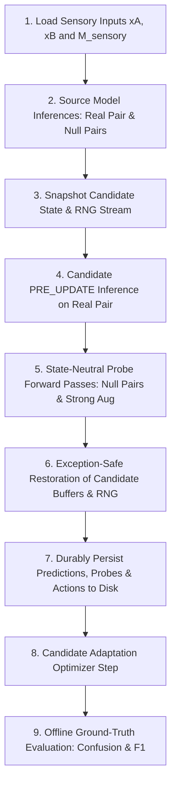

# ChangeGuard Plan V3: Work Package E5 Preflight Specification & Risk Evidence Contract

**Governing Document:** [`docs/MASTER_EXECUTION_PLAN_V3.md`](file:///usr1/home/s126mdg22_06/FYP_SARCD/ChangeGuard/docs/MASTER_EXECUTION_PLAN_V3.md) (Section 10: Block E5)  
**Configuration File:** [`configs/changeguard/e5_temporal_risk_v1.json`](file:///usr1/home/s126mdg22_06/FYP_SARCD/ChangeGuard/configs/changeguard/e5_temporal_risk_v1.json)  
**Repository:** `/usr1/home/s126mdg22_06/FYP_SARCD/ChangeGuard`  
**Execution Environment:** Miniconda `vfm_env` (`/usr1/home/s126mdg22_06/miniconda3/envs/vfm_env/bin/python`)  
**Base Terminal Commit:** `1d09e22d2ac35220e06836479492cf0cdb855110`  
**Status:** IMPLEMENTER PREFLIGHT SPECIFICATION & RISK MEASUREMENT CONTRACT (LOCKED)  

---

## 1. Executive Context & Methodological Role

In Work Package **`E5`**, the ChangeGuard project systematically investigates whether bi-temporal temporal null probes and generic risk indicators provide advance warning of adaptation harm without target-domain labels.

### Epistemic Role of Block E5: Risk Evaluation, Not Method Invention
Following the definitive negative promotion decisions in Block E2 (*Confidence & Augmentation*), Block E3 (*Source Anchors*), and Block E4 (*Class-Aware Interventions*), Plan V3 establishes that:
1. **No Standalone Adaptation Variant Was Promoted:** Neither confidence filtering, geometric augmentation, source-reference anchors, nor class-aware constraints resolved test-time adaptation collapse across the six development events.
2. **Candidate Status:** The candidate adaptation recipe (`candidate_e2_conf90` $\equiv$ `E4_BASE` $\equiv$ `E2_CONF_90`) is strictly an **internal evidence-collection platform**. It is **never** described as a promoted, winning, or superior adaptation method.
3. **The E5 Mission:** Rather than proposing a fifth unsupervised loss modification, E5 evaluates whether observable label-free risk evidence (temporal null pairs, predictive entropy, confidence, source KL divergence, parameter drift) can detect when adaptation is beneficial versus harmful before irreparable updates occur.

---

## 2. Model, Checkpoint & Data Boundaries

### 2.1 Model Architecture & Input Domain
- **Architecture:** `SNUNet_ECAM` (Model A, 2 input channels `[VV, VH]`, 3 output classes).
- **Temporal Input Pairs:**
  - **Real Pair:** `pre2/post` (canonical change detection input, $256 \times 256$, float32 standardized).
  - **Null Pair 1:** `pre2/pre2` (identical pre-event acquisitions; contains zero physical temporal change).
  - **Null Pair 2:** `post/post` (identical post-event acquisitions; contains zero physical temporal change).
- **Source Model Checkpoint:**
  - Seed 0 Path: `outputs/week5_source_all27/source_snunet_vvvh_all27_seed0_v1_fp32/final_checkpoint.pt`
  - Canonical File SHA-256: `247d358431f5c54c3d3d3421b4de6c4738ad457509900f8ddb717f5eef21087f`

### 2.2 Data Partitions & Strict Quarantine
- **Development Events (6 events, $N = 2,826$ patch pairs, 179 batches):**
  `[279, 437, 520, 559, 1111003, 1111008]`.
- **Sealed Test Events (10 events, $N = 1,093$ patch pairs):**
  `[205, 277, 321, 411, 445, 561, 562, 1111002, 1111007, 1111013]`.
  - **Forbidden Access Rule:** The sealed test partition is strictly quarantined. Zero sealed-test samples, rasters, or labels may be loaded, checked, or accessed during E5. Any attempt to pass a sealed event raises an immediate fail-closed `RuntimeError`.

---

## 3. Three Distinct Experimental Contexts

To avoid conflating normalization context shifts with parameter weight adaptation drift, three distinct execution contexts are maintained in code, metadata, and outputs:

| Context Identifier | Model State | Normalization Statistics Context | Optimization & Gradients | Epistemic Role |
| :--- | :--- | :--- | :--- | :--- |
| **`source_frozen_running_stats`** | Frozen Source Checkpoint (`247d3584...`) | Frozen training running statistics ($\mu_{\text{train}}, \sigma^2_{\text{train}}$); `eval()` mode | Zero backward calls, zero optimizer steps | Immutable reference baseline |
| **`matched_bn_no_update_bs16`** | Same initial checkpoint (`247d3584...`) | Current test-batch statistics ($\mu_{\text{batch}}, \sigma^2_{\text{batch}}$) | Zero backward calls, zero optimizer steps, zero parameter changes | Normalization context control |
| **`candidate_e2_conf90`** | Adapting model starting from checkpoint (`247d3584...`) | Current test-batch statistics ($\mu_{\text{batch}}, \sigma^2_{\text{batch}}$) | Adam $\text{lr}=10^{-4}$, BN affine parameters $(\gamma, \beta)$ only; `PRE_UPDATE` timing | Internal evidence collection platform |

---

## 4. Online vs Offline Mask Separation & Ground-Truth Sealing

In accordance with Plan V3 Section 3.3 and Section 10.1:

1. **Online Probe & Adaptation Mask Policy:**
   - Online validity is defined strictly by the physical sensory mask:
     $$M_{\text{sensory}} = (\text{MK0\_MNA} == 1)$$
   - Ground truth labels (`MK0_MLU`), label-derived invalid pixels (`label == 3`), true positives, false alarms, and F1 metrics are **strictly forbidden** from entering probe computation, adaptation loss masking, or update control.
2. **Offline Evaluation Mask Policy:**
   - The authoritative evaluation double-mask is applied strictly post-persistence:
     $$M_{\text{eval}} = (\text{MK0\_MNA} == 1) \land (\text{label} \ne 3)$$
3. **Fail-Closed Ground-Truth Sealing Lifecycle:**
   - During the streaming adaptation loop, evaluation labels are locked inside `LabelGuardedBatch`. Any attempt to call `batch.get_labels()` prior to `batch.mark_persisted()` raises an immediate `PermissionError`.

---

## 5. Frozen Risk Evidence Formulations

Every risk indicator is evaluated strictly **`PRE_UPDATE`** prior to the candidate adaptation step.

### 5.1 Primary Change-Specific Family: Temporal Null-Pair Probes
For each identical-time null pair $z \in \{\text{pre2/pre2}, \text{post/post}\}$:
$$\Delta_{\text{null}}(z) = \text{mean}_{M_{\text{sensory}}} p_{\text{candidate}}(\text{flood} \mid z) - \text{mean}_{M_{\text{sensory}}} p_{\text{source}}(\text{flood} \mid z)$$

The primary temporal null risk score is:
$$s_{\text{null}} = 0.5 \sum_{z \in \{\text{pre2/pre2}, \text{post/post}\}} \max\left(0, \Delta_{\text{null}}(z)\right)$$

**Mandatory Rules:**
- **Predeclared Risk Direction:** Higher $s_{\text{null}}$ indicates greater risk of hallucinating temporal change.
- **Probability Domain:** Computed strictly from softmax Class-2 flood probabilities, not hard predictions.
- **Zero-Valid Boundary Handling:** If either required null pair has zero sensory-valid pixels ($\sum M_{\text{sensory}} = 0$), $s_{\text{null}}$ is **`unavailable`** (`None` in Python, `null` in JSON, empty string in CSV). It is **NEVER** reported as numeric zero or assumed safe.
- **Normalization Attribution:** Both candidate and source normalization contexts are logged. Non-zero $s_{\text{null}}$ under differing normalization must not be attributed solely to weight drift.

### 5.2 Secondary Change-Specific Family: Source-Referenced Flood Dynamics
Evaluated on the real `pre2/post` acquisition pair:
$$s_{\text{flood\_expansion}} = \text{mean}_{M_{\text{sensory}}} \max\left(0, p_{\text{candidate}}(\text{flood}) - p_{\text{source}}(\text{flood})\right)$$
$$s_{\text{flood\_disappearance}} = \text{mean}_{M_{\text{sensory}}} \max\left(0, p_{\text{source}}(\text{flood}) - p_{\text{candidate}}(\text{flood})\right)$$

**Mandatory Rules:**
- Both signed directions are recorded under their declared names. They must **never** be combined post-hoc after inspecting outcomes.
- These signals measure divergence from the source distribution; they do **not** establish that the source model is correct.

### 5.3 Generic Risk Evidence Suite
Evaluated on the real `pre2/post` pair prior to the candidate update:
1. **Candidate Predictive Entropy:**
   $$H(p_{\text{cand}}) = -\frac{1}{|\Omega|} \sum_{i \in \Omega} \sum_{c=0}^2 p_{\text{cand}, c}(i) \log\left(p_{\text{cand}, c}(i) + \epsilon\right)$$
2. **Candidate Maximum Confidence:**
   $$\text{Conf}(p_{\text{cand}}) = \frac{1}{|\Omega|} \sum_{i \in \Omega} \max_{c \in \{0, 1, 2\}} p_{\text{cand}, c}(i)$$
3. **Source-to-Candidate KL Divergence (3-Class):**
   $$D_{\text{KL}}(p_{\text{cand}} \parallel p_{\text{source}}) = \frac{1}{|\Omega|} \sum_{i \in \Omega} \sum_{c=0}^2 p_{\text{cand}, c}(i) \log\left(\frac{p_{\text{cand}, c}(i) + \epsilon}{p_{\text{source}, c}(i) + \epsilon}\right)$$
   *Direction is fixed:* Candidate relative to source reference distribution.
4. **Hard Disagreement Rate:**
   $$\text{Disagreement} = \frac{1}{|\Omega|} \sum_{i \in \Omega} \mathbb{I}\left(\hat{y}_{\text{cand}}(i) \ne \hat{y}_{\text{source}}(i)\right)$$
5. **Signed & Absolute Flood Pixel Count Shift:**
   $$\Delta N_{\text{flood}} = \sum_{i \in \Omega} \mathbb{I}(\hat{y}_{\text{cand}}(i) == 2) - \sum_{i \in \Omega} \mathbb{I}(\hat{y}_{\text{source}}(i) == 2), \quad |\Delta N_{\text{flood}}| = |\Delta N_{\text{flood}}|$$
6. **Augmentation Inconsistency (Weak vs Strong Aligned):**
   $$\text{Inconsistency} = \frac{1}{2 |\Omega|} \sum_{i \in \Omega} \sum_{c=0}^2 \left|p_{\text{weak}, c}(i) - p_{\text{strong\_aligned}, c}(i)\right|$$
   where $p_{\text{strong\_aligned}}$ is evaluated on horizontally flipped inputs and flipped back to native coordinates.
7. **BN Affine Displacements ($L_2$ Norms):**
   $$\Delta_{\gamma} = \|\gamma_{\text{cand}} - \gamma_{\text{source}}\|_2, \quad \Delta_{\beta} = \|\beta_{\text{cand}} - \beta_{\text{source}}\|_2$$
8. **Sensory-Valid Pixel Count:** $N_{\text{valid}} = \sum M_{\text{sensory}}$.

---

## 6. Execution Order & State Isolation Invariants

For every streaming microbatch, the execution sequence strictly enforces:

### Invariants:
1. **Non-Aliasing:** `candidate_model`, `source_model`, and `bn_control_model` must share zero parameter or buffer pointers (`data_ptr()` pairwise intersection is strictly empty).
2. **Exception Safety:** On any probe failure or non-finite tensor, CPU and CUDA RNG states are restored, buffers are rolled back, and execution halts fail-closed.
3. **No Retrospective Leakage & Durable Pre-Label Persistence:** Ground truth labels are unlocked and read only after the batch's atomic evidence shard (`evidence_shards/batch_{step_index:06d}.npz`) is physically flushed, closed, verified via `np.load`, indexed in `evidence_index.json`, and verified to exist on disk. Step records (`step_records.json`) are progressively updated. `frozen_predictions.npz` is produced at event completion as a convenience aggregate, while batch shards remain the primary authoritative evidence.
4. **Disambiguated Dual Timing Semantics:**
   - **`prelabel_evidence_elapsed_ms`**: Measured from batch start through model forward passes, temporal probes, and evidence shard assembly immediately prior to shard persistence. Passed to `record_batch_evidence_shard(...)`, written to shard metadata and `evidence_index.json` (where legacy `timing_ms` is an alias mapping to this value), and recorded in step records.
   - **`batch_total_elapsed_ms`**: Measured from batch start through shard persistence, candidate adaptation update, and offline evaluation completion. Recorded at batch completion in `step_records.json` and step summary CSVs (`batch_time_ms` maintained as a backwards-compatible alias).

---

## 7. Performance Labeling & Evaluation Criteria

### 7.1 Primary Event Characterization
Across the 6 development events:
- **Harmful Event:** $\Delta\text{Macro F1} = \text{Macro F1}_{\text{candidate}} - \text{Macro F1}_{\text{source}} \le -0.010$ ($-1.0$ percentage points).
- **Beneficial Event:** $\Delta\text{Macro F1} \ge +0.010$ ($+1.0$ percentage points).
- **Neutral Event:** $|\Delta\text{Macro F1}| < 0.010$.

### 7.2 Discriminative Evaluation Protocol
- **Metrics:** AUROC, AUPRC (benchmarked against empirical harm prevalence / no-skill baseline).
- **Degenerate Handling:** If all samples in an event share a single class label, AUROC/AUPRC must be recorded as `unavailable` (`NA`), not artificially forced to 0.5 or 1.0.
- **Non-IID Discipline:** Batches across the six development events must **never** be treated as independent events.

---

## 8. Bounded GPU Smoke Specification (E5.1 Smoke Mode)

When authorized, the quarantined GPU smoke test executes under the following strict boundaries:
- **Event:** Event 520 only.
- **Sample Slice:** First 32 deterministic samples ($N = 32$, exactly 2 batches of 16).
- **Stream Factors:** Seed 0, Order A, reset per event, batch size 16.
- **Output Directory:** `outputs/e5_temporal_evidence/smoke_v4/` (strictly isolated from formal directories; `smoke_v1` preserved as preliminary dirty worktree smoke, `smoke_v2` preserved as clean timing failure, `smoke_v3` preserved as clean event-finalization failure).
- **Log Path:** `logs/e5_temporal_evidence/smoke_v4.log`
- **Tmux Session:** `cg_e5_1b_smoke_v4`
- **Verification Gates:**
  1. Finite losses and finite gradients.
  2. Source model parameter hash bit-exact before and after stream.
  3. Probes do not modify candidate buffers or RNG state.
  4. Predictions and step telemetry persisted before label evaluation.
  5. Sample count exactly 32 with zero duplication.
  6. Zero access to sealed test partition.

---

## 9. Empirical Resource Measurements & Execution Constraints

Based on empirical measurements from `smoke_v3`:
1. **Durable Evidence Storage Projections**:
   - `smoke_v3` generated exactly 77.95 MB of compressed authoritative batch shards (`batch_000000.npz`: 39.44 MB; `batch_000001.npz`: 38.50 MB) across 32 samples (~2.44 MB per sample).
   - Across the entire 6-development-event matrix ($N = 2,826$ patch pairs), projected shard storage is approximately 6.90 GB at the observed compression rate.
   - Including convenience aggregates (`frozen_predictions.npz`), tabular step summaries (`e5_step_risk_summary.csv`), manifests, and event metrics, total storage requirement is approximately 7.5 GB to 8.0 GB.
2. **GPU Memory Allocation & Concurrency Constraints**:
   - In `smoke_v3`, peak GPU VRAM allocation measured exactly 18,309.32 MB (~18.3 GB) on the 24,576 MB NVIDIA GeForce RTX 3090 (74.5% VRAM utilization).
   - **Strict Concurrency Rule**: Formal E5 execution must use strictly one process per physical 24 GB GPU. No co-located E5 process or other memory-intensive GPU task may share the device.
   - **Batch Discipline**: Batch size is strictly fixed at 16 in accordance with Plan V3; it must not be artificially lowered merely to reduce VRAM or disk footprint. Actual usage may vary slightly depending on event and batch spatial content.

---

## 10. Formal E5.2 Execution Specification & Bounded-Memory Architecture

### 10.1 Formal Cell Specification (`e5_temporal_risk_s0_oa_v1`)
- **Run Identifier:** `e5_temporal_risk_s0_oa_v1`
- **Output Directory:** `outputs/e5_temporal_evidence/formal_s0_oa_v1/`
- **Log Path:** `logs/e5_temporal_evidence/formal_s0_oa_v1.log`
- **Tmux Session:** `cg_e5_2_s0_oa_v1`
- **Target Partition:** All 6 declared development events in Order A sequence: `[279, 437, 520, 559, 1111003, 1111008]`.
- **Expected Total Samples:** 2,826 samples.
- **Expected Total Batches:** 179 batches (149 + 11 + 6 + 3 + 2 + 8).
- **Source Checkpoint Seed 0:** `outputs/week5_source_all27/source_snunet_vvvh_all27_seed0_v1_fp32/final_checkpoint.pt` (SHA-256: `247d358431f5c54c3d3d3421b4de6c4738ad457509900f8ddb717f5eef21087f`).
- **Internal Platform:** `candidate_e2_conf90` (Adam $\text{lr}=10^{-4}$, BN affine only, reset per event, PRE_UPDATE timing).
- **Mask Separation:** Online sensory mask `MK0_MNA == 1` only; offline double-mask `(MK0_MNA == 1) & (MK0_MLU != 3)` post-persistence.
- **Sealed Test Access:** Zero access.

### 10.2 Cache Finalization Audit & Bounded-Memory Shard Primacy Policy
1. **Authoritative Evidence Primacy**:
   - Every batch durably flushes an atomic shard to `event_{eid}/evidence_shards/batch_{step_index:06d}.npz`.
   - The authoritative shard contains all required raw probability arrays, masks, predictions, null pairs, and multi-context baselines for all samples in that batch.
   - `evidence_index.json` records complete metadata, sample IDs, and verified on-disk SHA-256 hashes.
2. **Convenience Aggregate Disabled for Formal Screening**:
   - Producing a monolithic per-event `frozen_predictions.npz` requires loading all shards for an event into an in-memory dictionary and re-compressing them.
   - For Event 279 alone ($N = 2,381$ samples across 149 batches), this would load over 57,000 arrays (>10.7 GB uncompressed RAM) simultaneously, risking out-of-memory termination and needlessly duplicating ~6.9 GB of storage.
   - **Policy:** In formal screening (`screening_specification`), `produce_convenience_aggregate` is explicitly set to `false`, and recorded in `initial_manifest.json` as `aggregate_cache_policy: "disabled_for_bounded_memory"`.
3. **Offline Analysis Access Rule**:
   - All subsequent scientific analysis, probe evaluation, and reporting scripts read directly from authoritative batch shards via `evidence_index.json` when `frozen_predictions.npz` is absent.

