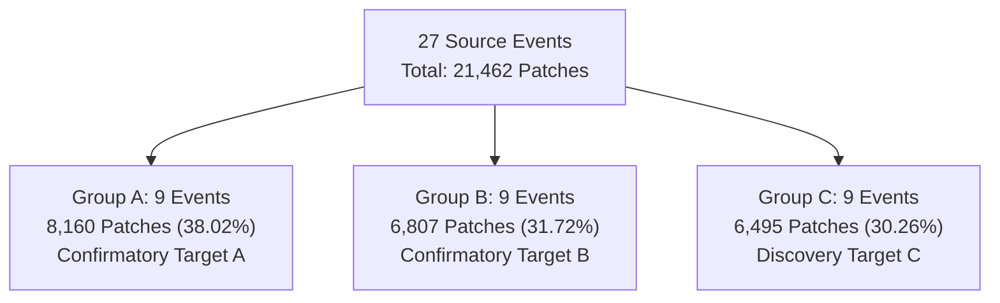

# RST1 Event-Fold Design: Deterministic Three-Fold Partitioning

**Document version:** 1.0.0
**Effective date:** 2026-10-26
**Status:** Approved and frozen event-fold partition
**Governing specification:** `configs/robust_source_training/rst1_event_folds_v1.json`

---

## 1. Design Objectives and Research Policy

To evaluate the generalization and stability of robust source-training recipes without test-set leakage or target-domain tuning, the 27 authorized source events are partitioned into three balanced, mutually disjoint groups of exactly 9 events each:
- **Group C (Discovery Fold):** Dedicated exclusively to the RST4 staircase ablation (R0, R1, R2, R3 on seed 0, trained on Groups A+B).
- **Group A (Confirmatory Fold A):** Reserved for confirmatory evaluation (training on Groups B+C, evaluated on Group A across seeds 0, 1, 2).
- **Group B (Confirmatory Fold B):** Reserved for confirmatory evaluation (training on Groups A+C, evaluated on Group B across seeds 0, 1, 2).

### Strict Outcome-Blind Requirement
The partition was constructed using only pre-existing metadata:
1. Event ID;
2. Eligible source patch count.

Zero model evaluation results, F1 scores, IoU values, losses, or test-time adaptation outcomes from historical phases were consulted or used. This guarantees complete methodological integrity.

---

## 2. Deterministic Partitioning Algorithm

The partitioning procedure follows a **Deterministic Constrained Greedy Algorithm**:

1. **Deterministic Ordering:** The 27 source events are sorted in descending order by eligible patch count. Any ties are broken by numeric event ID in ascending order.
2. **Constrained Assignment:** Iterating through the sorted events, each event is assigned to the eligible group (groups currently containing fewer than 9 events) that has the smallest cumulative patch count.
3. **Deterministic Tie-Breaking:** If multiple eligible groups have identical cumulative patch counts, the event is assigned in alphabetical group order (`Group_A`, `Group_B`, `Group_C`).
4. **Group Cardinality Constraint:** Exactly 9 events are assigned to each group.

---

## 3. Group Membership and Patch Accounting

### 3.1 Group A (Confirmatory Target A, Evaluated with Models Trained on B+C)

| Event ID | Eligible Patches | Percentage of Group A | Notes |
| :---: | :---: | :---: | :--- |
| **1111009** | 7,556 | 92.60% | Largest event in Kuro Siwo dataset |
| **273** | 112 | 1.37% | Small event |
| **118** | 108 | 1.32% | Small event |
| **498** | 102 | 1.25% | Small event |
| **567** | 96 | 1.18% | Small event |
| **554** | 71 | 0.87% | Small event |
| **421** | 68 | 0.83% | Small event |
| **174** | 26 | 0.32% | Very small event |
| **496** | 21 | 0.26% | Smallest event in dataset |
| **Total Group A** | **8,160** | **100.0%** | **9 Events (38.02% of source corpus)** |

### 3.2 Group B (Confirmatory Target B, Evaluated with Models Trained on A+C)

| Event ID | Eligible Patches | Percentage of Group B | Notes |
| :---: | :---: | :---: | :--- |
| **1111004** | 4,086 | 60.03% | Second largest event in dataset |
| **555** | 684 | 10.05% | Moderate event |
| **502** | 445 | 6.54% | Moderate event |
| **470** | 376 | 5.52% | Moderate event |
| **1111010** | 341 | 5.01% | Moderate event |
| **518** | 306 | 4.50% | Dataset median event (306 patches) |
| **267** | 218 | 3.20% | Moderate event |
| **324** | 189 | 2.78% | Moderate event |
| **417** | 162 | 2.38% | Moderate event |
| **Total Group B** | **6,807** | **100.0%** | **9 Events (31.72% of source corpus)** |

### 3.3 Group C (Discovery Target C, Evaluated with Models Trained on A+B)

| Event ID | Eligible Patches | Percentage of Group C | Notes |
| :---: | :---: | :---: | :--- |
| **427** | 1,980 | 30.49% | Third largest event in dataset |
| **1111011** | 1,619 | 24.93% | Fourth largest event in dataset |
| **275** | 742 | 11.42% | Moderate event |
| **1111005** | 620 | 9.55% | Moderate event |
| **497** | 398 | 6.13% | Moderate event |
| **147** | 362 | 5.57% | Moderate event |
| **1111006** | 313 | 4.82% | Moderate event |
| **130** | 248 | 3.82% | Moderate event |
| **492** | 213 | 3.28% | Moderate event |
| **Total Group C** | **6,495** | **100.0%** | **9 Events (30.26% of source corpus)** |

---

## 4. Experimental Role and Partition Dynamics

1. **Discovery Stage (Fold C):**
   - **Training Set:** Group A + Group B = 18 events, **14,967 patches** (69.74% of source data).
   - **Evaluation Set:** Group C = 9 events, **6,495 patches** (30.26% of source data).
   - **Purpose:** Compares R0, R1, R2, R3 under seed 0. Group C results are used strictly for recipe exploration and component selection.
2. **Confirmatory Stage (Folds A & B):**
   - **Fold A:** Train on B + C (18 events, **13,302 patches**, 61.98%), evaluate on Group A (**8,160 patches**).
   - **Fold B:** Train on A + C (18 events, **14,655 patches**, 68.28%), evaluate on Group B (**6,807 patches**).
   - **Purpose:** Frozen evaluation of the promoted recipe vs. matched R0 across seeds 0, 1, and 2. Folds A and B remain strictly unopened during the discovery phase.
3. **Partition Balance:**
   - The theoretical unconstrained mean is $21,462 / 3 = 7,154.0$ patches per group.
   - Because Event 1111009 contains 7,556 patches alone, Group A necessarily contains at least 7,556 patches. The constrained greedy algorithm achieved the optimal possible balance under the 9-event constraint:
     - Group A: 8,160 patches ($+14.06\%$ from mean)
     - Group B: 6,807 patches ($-4.85\%$ from mean)
     - Group C: 6,495 patches ($-9.21\%$ from mean)

---

## 5. Permanence and Integrity Invariant

This fold assignment is permanently frozen in `configs/robust_source_training/rst1_event_folds_v1.json`. Manual swapping, post-hoc regrouping, or fold filtering after viewing training outcomes is strictly prohibited.
