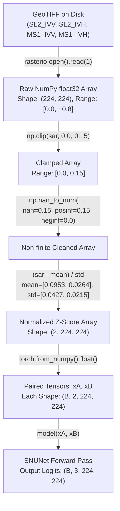

# RST1 Input-Domain and Preprocessing Audit

**Document version:** 1.0.0
**Audit date:** 2026-10-26
**Status:** Approved technical audit for robust source training
**Audited modules:**
- `src/data/source_dataset.py` (HEAD: `KuroSourceDataset`)
- `src/data/kuro_dataset.py` (canonical loader definitions)
- `third_party/KuroSiwo/configs/train/data_config.json` (upstream configuration)
- `docs/source_data_pipeline_audit.md` (Week 0 authoritative technical audit)

---

## 1. Executive Summary

This audit establishes the rigorous ground-truth data representation, loading sequence, and preprocessing pipeline for Sentinel-1 Synthetic Aperture Radar (SAR) observations in the ChangeGuard robust source-training route. Every design parameter has been verified from executable code and underlying GeoTIFF metadata.

The primary finding is that stored SAR rasters are **linear amplitude backscatter** (square root of radar intensity $\sqrt{I}$), not decibels ($\text{dB}$) and not calibrated radar cross-section ($\sigma^0$). Consequently, all future radiometric augmentations (Component M3) must be formulated strictly in the linear amplitude domain prior to z-score standardization.

---

## 2. Code Path: Stored File to Model Tensor

The exact execution path from disk storage to model forward pass is:



---

## 3. Detailed Parameter Verification

### 3.1 Stored SAR Radiometric Representation
- **Representation:** Sentinel-1 Ground Range Detected (GRD) **linear amplitude backscatter**.
- **Physical Meaning:** Pixel intensities represent raw linear digital amplitudes ($\sqrt{I}$), proportional to radar backscattered electric field amplitude.
- **Evidence:** Verified by Bountos et al. (NeurIPS 2024 dataset descriptor), corroborated by `docs/source_data_pipeline_audit.md:40–44`, and confirmed by raw raster pixel statistics where over 95% of pixel values reside in $[0.0, 0.15]$.
- **Critical Negative Affirmation:** Stored values are **NOT in decibels (dB)** ($10 \log_{10} \sigma^0$) and **NOT calibrated sigma-nought ($\sigma^0$) power**. Applying multiplicative speckle or additive decibel offsets directly without linear domain transformation is strictly prohibited.

### 3.2 Data Types On Disk and In Memory
- **On Disk:** Cloud-Optimized GeoTIFF (`.tif`), single band, `float32`.
- **In Memory (Pre-tensor):** NumPy `ndarray`, dtype `float32`.
- **In Model Input:** PyTorch `torch.FloatTensor`, dtype `torch.float32`.

### 3.3 NoData Encoding and Clamping
- **NoData on Disk:** GeoTIFF tags occasionally specify nodata, but missing observations manifest as non-finite values (`NaN`, $+\infty$, $-\infty$) or boundary zero values.
- **Clamping Order & Bounds:**
  ```python
  sar = np.clip(sar, 0.0, 0.15)
  sar = np.nan_to_num(sar, nan=0.15, posinf=0.15, neginf=0.0)
  ```
  - Lower clamp: $0.0$ (physical minimum for linear amplitude).
  - Upper clamp: $0.15$ (established in `configs/train/data_config.json:14` and `src/data/source_dataset.py:281`).

### 3.4 Normalization Scheme and Constants
- **Formula:** Channel-wise standardization:
  $$\hat{x}_{c} = \frac{x_c - \mu_c}{\sigma_c}$$
- **Normalization Constants:**
  - $\mu_{\text{VV}} = 0.0953, \quad \sigma_{\text{VV}} = 0.0427$
  - $\mu_{\text{VH}} = 0.0264, \quad \sigma_{\text{VH}} = 0.0215$
- **Normalization Scope:** **Global fixed constants**. Normalization is NOT computed per patch and NOT computed per event.
- **Provenance:** Inherited from upstream Kuro Siwo benchmark (`configs/train/data_config.json:16–17`). Although the exact historical sample pool used to compute these constants was not preserved in upstream repository git history, the numerical constants remain fixed and frozen across all ChangeGuard models to ensure bit-level protocol matching.

### 3.5 Channel Ordering and Temporal Alignment
- **Channel Ordering:**
  - Channel 0: **VV** (Vertical transmit, Vertical receive polarization)
  - Channel 1: **VH** (Vertical transmit, Horizontal receive cross-polarization)
- **Temporal Pairing:**
  - `xA` (Pre-event observation): Canonical **`pre_event_2`** (files with prefix `SL2_IVV`, `SL2_IVH`).
  - `xB` (Post-event observation): Post-disaster acquisition (files with prefix `MS1_IVV`, `MS1_IVH`).
  - `pre_event_1` (`SL1_IVV`, `SL1_IVH`) is reserved for counterfactual null-pair probes and is not used in the primary training stream.

### 3.6 Spatial Dimensions
- **Dimensions:** Exactly $224 \times 224$ pixels at $10\text{ m}$ ground sample distance.
- **Resizing / Cropping:** None. No spatial resizing, random cropping, or padding is performed. Every patch is read at native resolution.

### 3.7 Sensory Masking, Labels, and Double-Masking Rule
- **Sensory Mask (`MK0_MNA`):** Binary coverage mask (uint8) where $1 = \text{valid observation}$, $0 = \text{no satellite coverage/orbit boundary}$.
- **Semantic Label (`MK0_MLU`):** Multi-class annotation mask (int64):
  - `0`: No Water (dry land / background)
  - `1`: Permanent Water (pre-existing lakes, rivers, reservoirs)
  - `2`: Flood Water (newly inundated flood water — primary target change class)
  - `3`: Invalid / Ignore (`ignore_index = 3`)
- **Double-Masking Rule:** In `src/data/source_dataset.py:316`:
  ```python
  mlu[mna == 0] = 3
  ```
  Any pixel lacking valid satellite sensor coverage is forcibly mapped to class 3 (`ignore_index`).
- **Evaluation Validity Invariant:**
  ```python
  valid = (valid_mask == 1) & (label != 3)
  ```

### 3.8 Isolation of Labels from Model Forward Pass
- **Strict Isolation:** Labels (`label`) and valid masks (`valid_mask`) are used strictly in loss calculation during training or metric computation during evaluation.
- Under zero circumstances do labels or label-derived masks enter the model's neural network inputs. The model receives exclusively `xA` and `xB`.

### 3.9 Current Data Augmentation State
- **Current Baseline Recipe (R0):** **Strictly None**. Data augmentations are disabled (`data_augmentations: false`).
- **Implications for Component M3:** When paired geometric and radiometric augmentations are introduced in RST3:
  1. Geometric augmentations (rotations, horizontal/vertical flips) must be applied synchronously to pre-event imagery, post-event imagery, and ground-truth label tensors.
  2. Radiometric gain/offset must be applied in the **linear amplitude domain** before the clamp and z-score normalization step.

---

## 4. Conclusion and Technical Bounds

The input pipeline is completely verified from code. All 21,462 patches in the 27 source events conform to these specifications. The input domain is established as linear amplitude, removing ambiguity for downstream component development.
